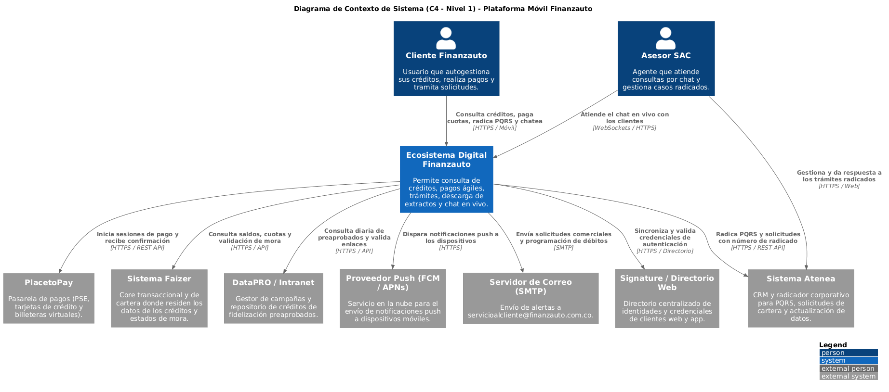
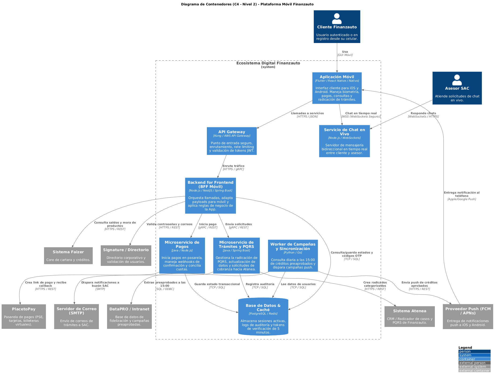
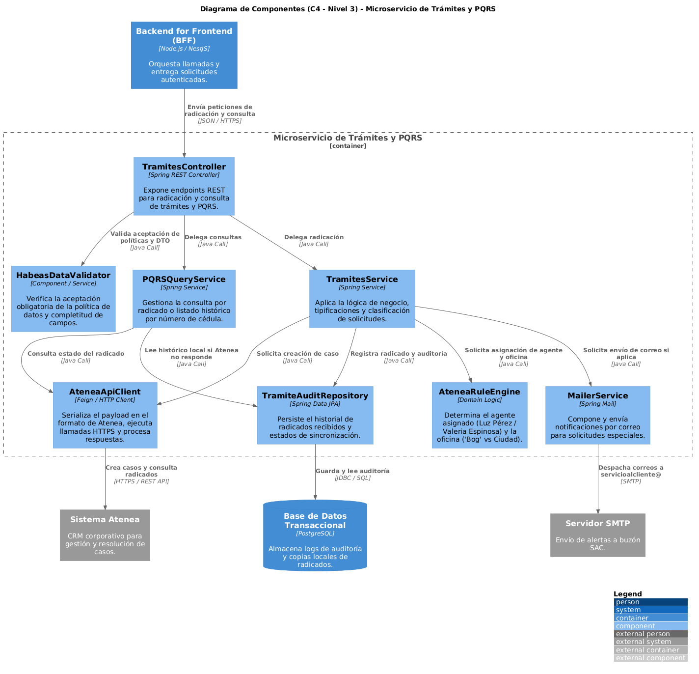
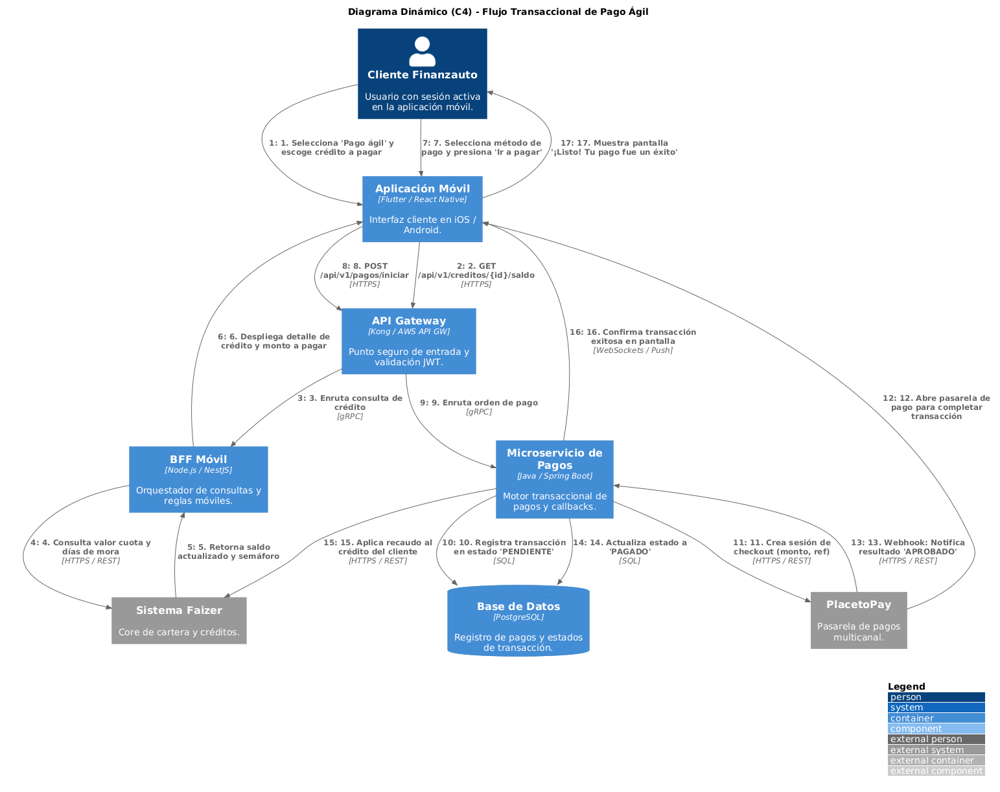
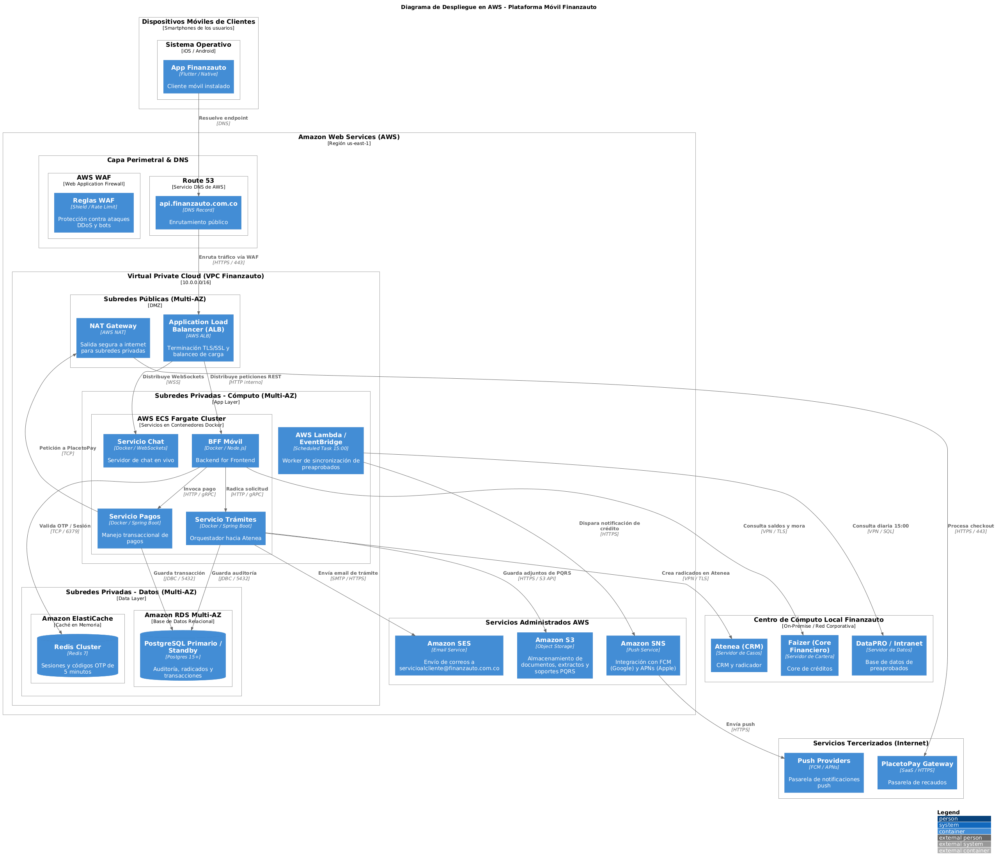

# Estándar de Modelado de Arquitectura - Finanzauto Mobile 2024

Este documento define la arquitectura de software de la aplicación móvil de Finanzauto siguiendo el modelo C4 (Contexto, Contenedores, Componentes y Vistas Dinámicas).

---

## 1. Nivel 1: Contexto del Sistema (System Context)
Muestra cómo interactúa el cliente y el equipo de SAC con el ecosistema y sus dependencias externas.

* **Código fuente:** `docs/diagramas/c4-nivel1-contexto.puml`
* **Principales integraciones:**
  * **PlacetoPay:** Pasarela de recaudos multicanal.
  * **Atenea:** CRM y sistema corporativo de radicación.
  * **Faizer:** Core transaccional de cartera y créditos.
  * **DataPRO:** Repositorio de créditos preaprobados.

---

## 2. Nivel 2: Contenedores (Containers)
Zoom dentro del ecosistema digital para observar las aplicaciones cliente, servicios de backend y almacenamiento.

* **Código fuente:** `docs/diagramas/c4-nivel2-contenedores.puml`
* **Piezas arquitecturales:**
  * **App Móvil:** iOS / Android (Flutter / React Native).
  * **API Gateway & BFF Móvil:** Punto único de acceso y adaptación móvil.
  * **Microservicio de Trámites y PQRS:** Gestión hacia Atenea.
  * **Microservicio de Pagos:** Integración hacia PlacetoPay y Faizer.
  * **Worker Cron Preaprobados:** Ejecución batch diaria a las 15:00.

---

## 3. Nivel 3: Componentes (Components)
Estructura interna del **Microservicio de Trámites y PQRS**.

* **Código fuente:** `docs/diagramas/c4-nivel3-componentes.puml`
* **Módulos clave:**
  * `TramitesController`: Endpoints de radicación y consulta.
  * `HabeasDataValidator`: Validación de consentimiento informado.
  * `AteneaRuleEngine`: Asignación automática de analistas y regla territorial ("Bog" vs Ciudad).
  * `AteneaApiClient`: Integración HTTP con Atenea.

---

## 4. Diagrama Dinámico: Flujo Transaccional de Pago
Secuencia numerada de la transacción de pago ágil de cuota.

* **Código fuente:** `docs/diagramas/c4-nivel4-dinamico-pagos.puml`

---

## 5. Diagrama de Despliegue en AWS (Deployment Diagram)
Mapeo de contenedores y servicios sobre la infraestructura en la nube de Amazon Web Services (AWS) con conectividad híbrida hacia los centros de datos corporativos.

* **Código fuente:** `docs/diagramas/c4-despliegue-aws.puml`
* **Capa Perimetral:** AWS Route 53 + AWS WAF para mitigación de ataques y control de tráfico.
* **Cómputo:** AWS ECS con Fargate para contenedores de alta disponibilidad (Multi-AZ) sin gestión de servidores.
* **Almacenamiento y Caché:** Amazon RDS PostgreSQL Multi-AZ, Amazon ElastiCache (Redis) para tokens de sesión y Amazon S3 para documentos adjuntos.
* **Integración Híbrida:** Enlace seguro por VPN / Direct Connect hacia los servicios on-premise corporativos (Atenea, Faizer, DataPRO).